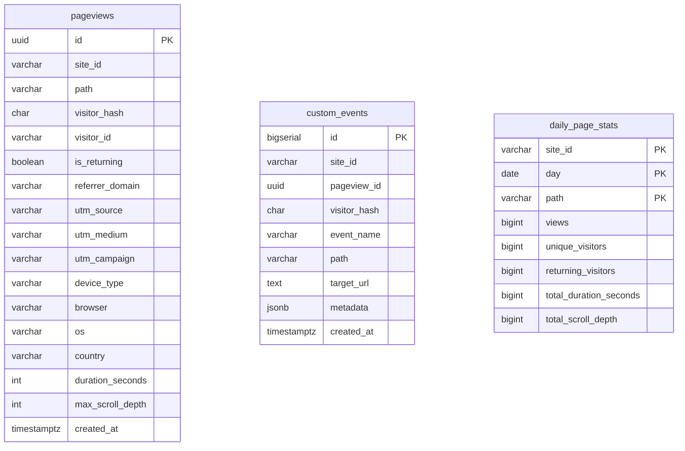

# Data Models (`internal/data`)

`analytics.etin.dev` uses a hybrid 3-table PostgreSQL design (Option C):

## Why This Design?

1. **In-Place Engagement Updates (`pageviews`)**:
   - When a visitor opens a page, one row is inserted with a client-generated `id` (UUID).
   - As they read and scroll, periodic beacons update `duration_seconds = GREATEST(duration_seconds, $2)` and `max_scroll_depth = GREATEST(max_scroll_depth, $3)` on that same row—keeping storage 10x–20x smaller than append-only heartbeat logs.
2. **Outbound Clicks & Custom Events (`custom_events`)**:
   - Discrete actions (like clicking an external link to GitHub/LinkedIn) are recorded in `custom_events`.
3. **Permanent Daily Rollups (`daily_page_stats`)**:
   - `RollupDay` aggregates raw `pageviews` into `(site_id, day, path)` summaries using `ON CONFLICT DO UPDATE`.
   - Public lifetime view counts (`GET /v1/public/stats`) read from `daily_page_stats` + today's live `pageviews`, so you can prune old raw `pageviews` rows after your retention window (e.g. 365 days) without ever losing lifetime view counts or average reading time.
